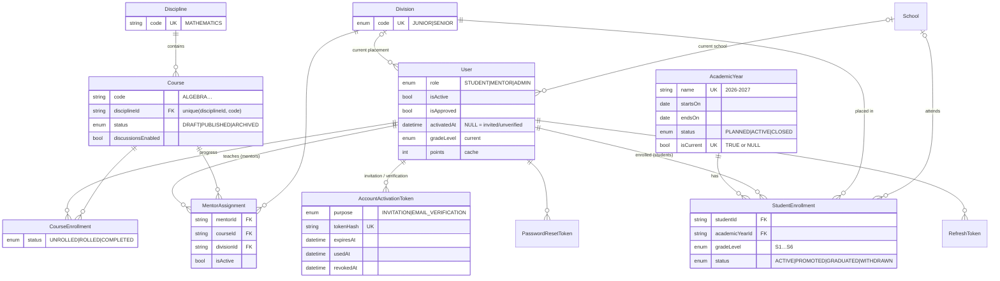
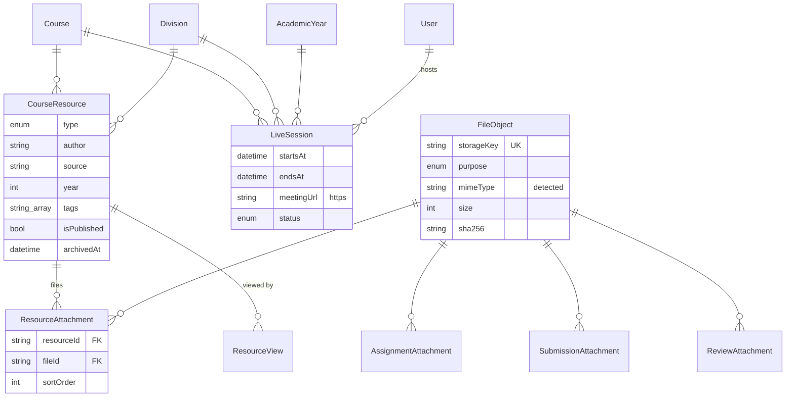
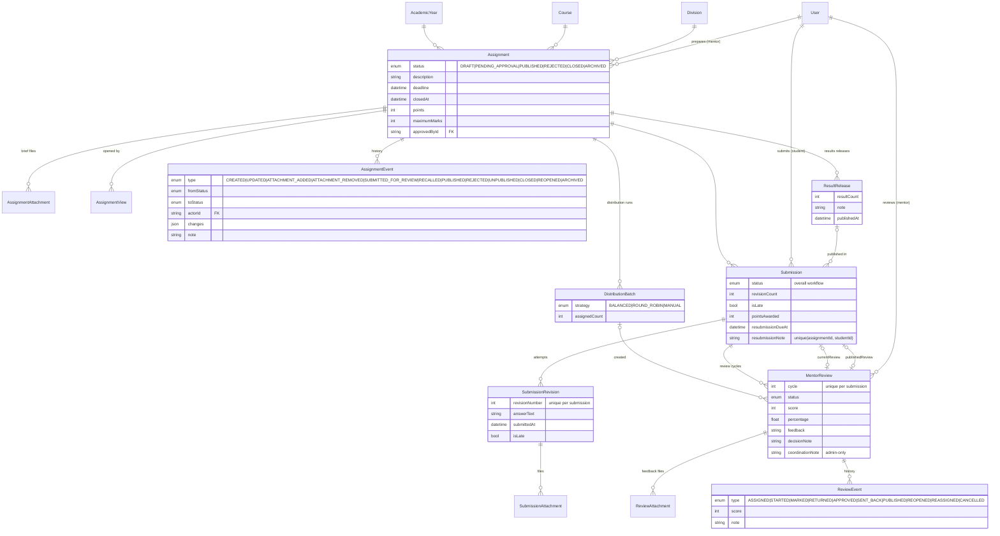
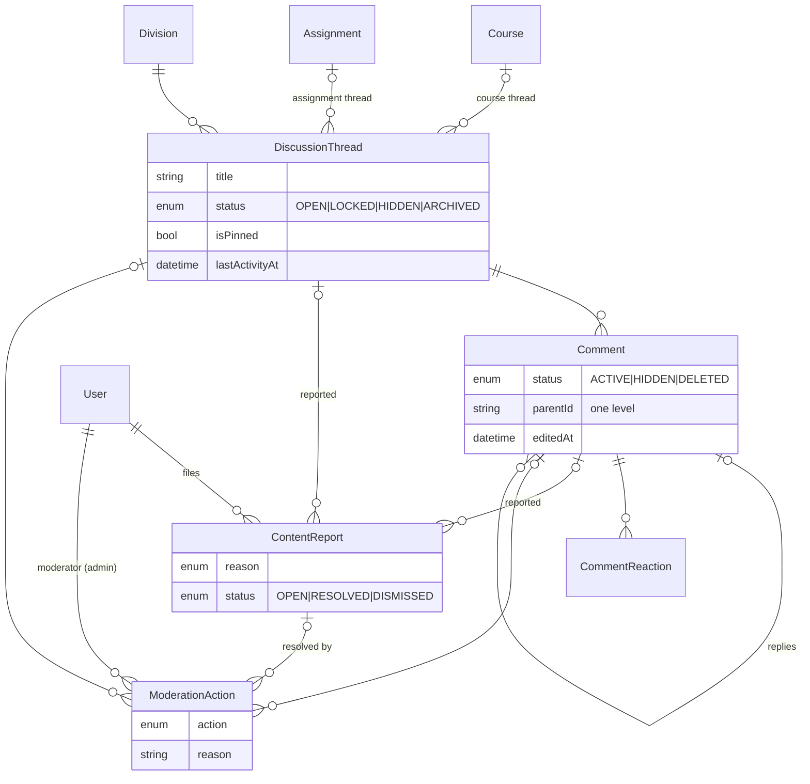
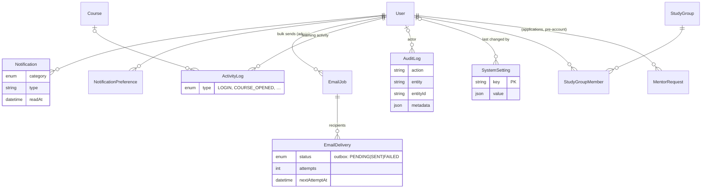

# ROF LMS — Database

PostgreSQL 14+, managed with Prisma 7. The source of truth is
[`prisma/schema.prisma`](../prisma/schema.prisma) (every model and field is
commented). This document explains the design, the policies and how to run
migrations and seeds.

- [1. Design principles](#1-design-principles)
- [2. Entity-relationship diagrams](#2-entity-relationship-diagrams)
- [3. Table reference](#3-table-reference)
- [4. Integrity rules](#4-integrity-rules)
- [5. Deletion, archival and retention](#5-deletion-archival-and-retention)
- [6. Roles and permissions](#6-roles-and-permissions)
- [7. Adding another discipline later](#7-adding-another-discipline-later)
- [8. Migrations](#8-migrations)
- [9. Seeding](#9-seeding)

---

## 1. Design principles

1. **Scope = course × division.** Learning content (resources, assignments,
   live sessions, course discussions) belongs to one course *and* one division.
   Junior and Senior Algebra share a `Course` row but never share content.
2. **History is kept, not overwritten.** A student has one `StudentEnrollment`
   per academic year; every submission attempt is a `SubmissionRevision`;
   every review cycle is a `MentorReview` with an append-only `ReviewEvent`
   log; every distribution run is a `DistributionBatch`; every results
   release is a `ResultRelease`; every moderation decision is a
   `ModerationAction`.
3. **One place per fact.** Files are stored once (`FileObject`) and attached
   through join tables. The few deliberate copies are caches maintained in the
   same transaction and documented below (`User.points`, the student's current
   placement on `User`, `Submission.status`).
4. **Archive, don't delete,** anything with academic or audit value.
5. **Constraints in the database,** not only in code: foreign keys, unique
   keys and CHECK constraints guard the invariants even against buggy code.
6. **Safe evolution.** Schema changes use *expand → backfill → contract*;
   destructive steps are prepared in `prisma/pending-migrations/` and applied
   only after approval and a backup.

## 2. Entity-relationship diagrams

The model has 44 tables; the diagrams are split by area. `||--o{` = one to
many, `|o--o|` = optional one to one.

### 2.1 People and academic structure



### 2.2 Learning content and files



### 2.3 Assessment workflow



### 2.4 Discussions and moderation



### 2.5 Notifications, logs and administration



## 3. Table reference

| Area | Table | Purpose | Notable keys / indexes |
|---|---|---|---|
| Identity | `User` | Every account; `role` = STUDENT, MENTOR or ADMIN | unique `username`, `email`; idx `role`, `divisionId`, `points` |
| | `RefreshToken` | Rotating refresh tokens (SHA-256 only) | unique `tokenHash`; idx `familyId` |
| | `PasswordResetToken` | Single-use reset links | unique `tokenHash` |
| | `AccountActivationToken` | Single-use invitation / e-mail-verification links (hash only; a new link revokes older ones) | unique `tokenHash`; idx `userId` |
| | `TokenBlacklist` | Revoked access tokens until expiry | unique `jti` |
| | `MentorRequest` | Mentor applications before an account exists | unique `username`, `email` |
| | `School` | Normalised school names | unique `name` |
| Structure | `Discipline` | Subject area (Mathematics) | unique `code` |
| | `Course` | The four Mathematics courses | unique (`disciplineId`, `code`) |
| | `Division` | JUNIOR (S1–S3), SENIOR (S4–S6) | unique `code` |
| | `AcademicYear` | School years; exactly one current | unique `name`, unique `isCurrent` |
| | `StudentEnrollment` | Student × year: grade, division, school, status | unique (`studentId`, `academicYearId`) |
| | `MentorAssignment` | Mentor × course × division (their scope) | unique (`mentorId`, `courseId`, `divisionId`) |
| | `CourseEnrollment` | Student progress per course (Unrolled → Completed) | unique (`courseId`, `studentId`) |
| Content | `CourseResource` | Learning material for a course × division, with author/source/year/tags metadata | idx (`courseId`, `divisionId`, `isPublished`), GIN (`tags`); CHECK year 1800–2200, ≤ 20 tags |
| | `ResourceAttachment` | Files of a resource (ordered) | unique (`resourceId`, `fileId`) |
| | `ResourceView` | Who opened which resource (analytics) | unique (`resourceId`, `studentId`) |
| | `LiveSession` | External meeting for a course × division in a year | idx (`courseId`, `divisionId`, `startsAt`) |
| | `FileObject` | Metadata of every stored file | unique `storageKey` |
| Assessment | `Assignment` | Prepared by a mentor, published by an admin | idx (`courseId`, `divisionId`, `status`), (`academicYearId`, `status`) |
| | `AssignmentAttachment` | Brief files | unique (`assignmentId`, `fileId`) |
| | `AssignmentView` | Drives “New” vs “Opened” | unique (`assignmentId`, `studentId`) |
| | `AssignmentEvent` | Append-only assignment history (edits with before/after values, every status change, file changes) | idx (`assignmentId`, `createdAt`), (`actorId`) |
| | `Submission` | One per student per assignment; overall status; the open resubmission request (note, due date) | unique (`assignmentId`, `studentId`); unique `currentReviewId`, `publishedReviewId`; CHECK request fields all set or all null |
| | `SubmissionRevision` | Every attempt (1, 2, 3 …): typed answer, files, time, lateness | unique (`submissionId`, `revisionNumber`) |
| | `SubmissionAttachment` | Files of an attempt | unique (`revisionId`, `fileId`) |
| | `DistributionBatch` | One admin distribution run | idx `assignmentId` |
| | `MentorReview` | One review cycle (score, feedback, decisions) | unique (`submissionId`, `cycle`); idx (`mentorId`, `status`) |
| | `ReviewAttachment` | Mentor feedback files | unique (`reviewId`, `fileId`) |
| | `ReviewEvent` | Append-only review history | idx (`reviewId`, `createdAt`) |
| | `ResultRelease` | One admin results publication | idx `assignmentId` |
| Community | `DiscussionThread` | Topic in a course (per division) or assignment | idx (`courseId`, `divisionId`, `status`, `lastActivityAt`) |
| | `Comment` | Message in a thread; one level of replies | idx (`threadId`, `parentId`, `createdAt`) |
| | `CommentReaction` | LIKE / HELPFUL / CONFUSED | unique (`commentId`, `userId`, `type`) |
| | `ContentReport` | A user's report of a thread or comment | unique (`reporterId`, `commentId`), (`reporterId`, `threadId`) |
| | `ModerationAction` | Every moderation decision | idx `commentId`, `threadId`, (`moderatorId`, `createdAt`) |
| | `StudyGroup`, `StudyGroupMember` | Admin-managed cohorts | unique (`groupId`, `userId`) |
| Messaging | `Notification`, `NotificationPreference` | In-app notifications; e-mail opt-outs | idx (`userId`, `readAt`) |
| | `EmailJob`, `EmailDelivery` | Bulk sends; outbox for every e-mail | unique `idempotencyKey`; idx (`status`, `nextAttemptAt`) |
| Admin | `SystemSetting` | Allow-listed key/value settings | PK `key` |
| | `AuditLog` | Who changed what (security/governance) | idx `actorId`, `action`, (`entity`, `entityId`), `createdAt` |
| | `ActivityLog` | What learners do (analytics) | idx (`userId`, `createdAt`), (`courseId`, `type`, `createdAt`) |

**Deliberate copies (caches).**

| Copy | Source of truth | Kept in sync by |
|---|---|---|
| `User.gradeLevel / divisionId / schoolId` | the ACTIVE `StudentEnrollment` of the current year | written in the same transaction by `AcademicYearsService` |
| `User.points / problemsSolved` | `Submission.pointsAwarded` of PUBLISHED submissions | recomputed in the publish/reopen transaction; `POST /admin/leaderboard/recompute` |
| `Submission.status` | the current `MentorReview.status` | both updated in the same transaction (used for fast filtering) |

## 4. Integrity rules

Enforced by PostgreSQL (in addition to every foreign key):

| Rule | How |
|---|---|
| One submission per student per assignment | unique (`assignmentId`, `studentId`) |
| Revision and review-cycle numbers unique | unique (`submissionId`, `revisionNumber`), (`submissionId`, `cycle`) |
| Exactly one current academic year | `isCurrent` is TRUE or NULL (CHECK) + unique index |
| Academic year ends after it starts | CHECK `endsOn > startsOn` |
| A student has a grade and a division | CHECK on `User` |
| A thread / report targets exactly one thing | CHECK on `DiscussionThread`, `ContentReport` |
| Marks are positive; scores non-negative | CHECK on `Assignment`, `Submission`, `MentorReview` |
| Live sessions end after they start | CHECK on `LiveSession` |
| A user reports an item once | unique (`reporterId`, `commentId` / `threadId`) |

Enforced by the application (needs data from other rows): grade ↔ division
match; a review's score ≤ the assignment's maximum marks; mentors act only in
their scope; status transitions (conditional `UPDATE … WHERE status IN …`).

## 5. Deletion, archival and retention

**Foreign-key behaviour** is chosen per relation:

- `Restrict` — academic records can't lose their owner: a user with
  submissions, reviews, assignments, threads or moderation history cannot be
  deleted (the API answers `USER_HAS_HISTORY`; suspend instead). Academic
  years, divisions and disciplines in use cannot be deleted.
- `Cascade` — pure children: attachments with their parent, revisions and
  review cycles with their submission, comments with their thread, tokens and
  notifications with their user.
- `SetNull` — optional references that must not block deletion (e.g.
  `AuditLog.actorId`, `ModerationAction.commentId`).

**Policy by entity:**

| Entity | Policy |
|---|---|
| Users | Suspend (`isActive=false`); hard delete only without academic history. Withdrawn students: enrolment `WITHDRAWN` + suspended. Invited accounts stay un-activated until the link is used; unused links expire (7 days invitation, 48 h verification). |
| Academic years | Never deleted; `CLOSED` when the next year is activated. |
| Courses | Never deleted; `ARCHIVED` (hidden from students, kept). |
| Assignments | `CLOSED` automatically at the deadline (unless late work is accepted) or by an admin; reopening needs a future deadline. `ARCHIVED` by admin or automatically when their year closes (read-only; results stay visible). Unpublish only while no submissions exist. Every change is kept in `AssignmentEvent`. |
| Resources | Archive (hidden, kept) or delete (attachments cascade; file bytes removed by the nightly orphan cleanup). |
| Submissions, revisions, reviews, review events, result releases | Never deleted. Corrections create new review cycles. |
| Threads | Lock, hide or archive; never deleted by the API. Comments are soft-deleted (`[deleted]` placeholder keeps the thread readable). |
| Reports, moderation actions, audit log | Never deleted. |
| Files | Deleted only when nothing references them (nightly, after 24 h). |

**Retention (nightly jobs):**

| Data | Kept for |
|---|---|
| `ActivityLog` | 400 days |
| Read `Notification` | 180 days |
| Body/subject of SENT `EmailDelivery` | 90 days (delivery record kept) |
| Expired/used tokens | removed hourly |

## 6. Roles and permissions

Roles are stored on `User.role`. Permissions are **defined in code**
([`src/auth/permissions.ts`](../src/auth/permissions.ts)), not in tables: there
are three fixed roles and the rules are part of the academic workflow (for
example, administrators never grade). The API enforces them with `@Roles()`
on every route plus scope checks; a unit test keeps the permission map and the
route decorators consistent. Clients read the map from `GET /api/v1/me/permissions`.

## 7. Adding another discipline later

No schema change is needed:

1. Insert a `Discipline` (e.g. `PHYSICS`) and its `Course` rows (codes are
   unique per discipline).
2. Assign mentors to the new courses × divisions.

Everything else — resources, assignments, reviews, discussions, analytics —
already works per course. (Only the seed and admin UI would gain options.)

## 8. Migrations

```bash
# Apply all pending migrations (safe for production; never resets data)
npm run db:migrate                 # = prisma migrate deploy

# See what is applied
npx prisma migrate status

# Check the database matches schema.prisma (CI does this)
npx prisma migrate diff --from-config-datasource --to-schema prisma/schema.prisma --exit-code
```

**History.**

| Migration | Kind | Content |
|---|---|---|
| `20261103000000_baseline` | initial | Full schema as of 3 Nov 2026 (the original broken chain is archived in `prisma/migrations_archive/`). |
| `20261104000000_academic_structure_reviews_moderation` | expand (additive) | Disciplines, academic years and enrolments, attachment tables, review cycles/events, distribution batches, result releases, threads, reports, moderation actions, activity log; **backfills** all existing data into them. |
| `20261106000000_account_activation` | expand (additive) | `User.activatedAt` and `AccountActivationToken`; existing accounts with a password are backfilled as activated. |
| `20261107000000_drop_superseded_columns` | contract (destructive, approved 2026-11-03) | Drops the 27 columns superseded by the expand migration, after verifying every value exists in the new tables (it aborts otherwise). Applied after a full backup. |
| `20261108000000_course_discussions_resource_metadata` | additive | `Course.discussionsEnabled` (admins turn a course's discussions off; default on) and resource metadata `author`, `source`, `year`, `tags`. |
| `20261109000000_assignment_history_closed_status` | additive + backfill | `AssignmentStatus.CLOSED`, `Assignment.description`/`closedAt`, and the `AssignmentEvent` history table, backfilled from the audit log (plus a `CREATED` entry for assignments without one). |
| `20261110000000_submission_answers_resubmission_requests` | additive | `RESUBMISSION_REQUESTED` in `SubmissionStatus`/`ReviewStatus` (+ request/withdraw `ReviewEventType`s), `Submission.resubmissionRequestedAt/DueAt/Note`, `SubmissionRevision.answerText`. |

**Making a schema change.**

1. Edit `prisma/schema.prisma`.
2. `npx prisma migrate dev --create-only --name <change>` (against a
   development database) and **read the generated SQL**.
3. If it drops, renames or makes a populated column required, rewrite it as
   expand → backfill → contract: add nullable, copy data, then enforce; put any
   drop in a later, separately approved migration.
4. `npx prisma migrate dev` to apply locally, then commit the migration folder.
5. Never edit a migration that has been applied anywhere; never use
   `migrate reset` or `db push` on shared databases.

## 9. Seeding

```bash
npm run db:seed                    # = prisma db seed (idempotent)
SEED_DEMO=true npm run db:seed     # + demo mentors/students (refused in production)
```

The seed creates only what is missing — it never overwrites edits:

| Data | Rule |
|---|---|
| Discipline | `MATHEMATICS` |
| Divisions | `JUNIOR` (S1–S3), `SENIOR` (S4–S6) |
| Courses | Algebra, Geometry, Number Theory, Combinatorics |
| Academic year | if none is current: the September–July year containing today, made current |
| Enrolments | every active student without one gets an enrolment in the current year |
| First admin | only if no admin exists; password from `SEED_ADMIN_PASSWORD`, or generated and printed once |

**First-time setup of a new environment:**

```bash
npm ci
npx prisma generate
npm run db:migrate
npm run db:seed
```
