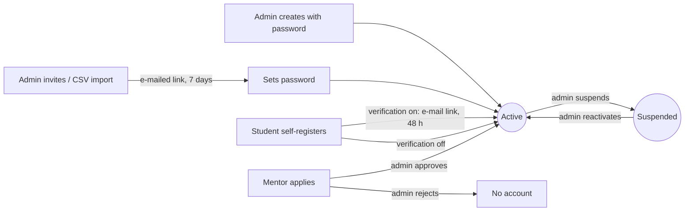
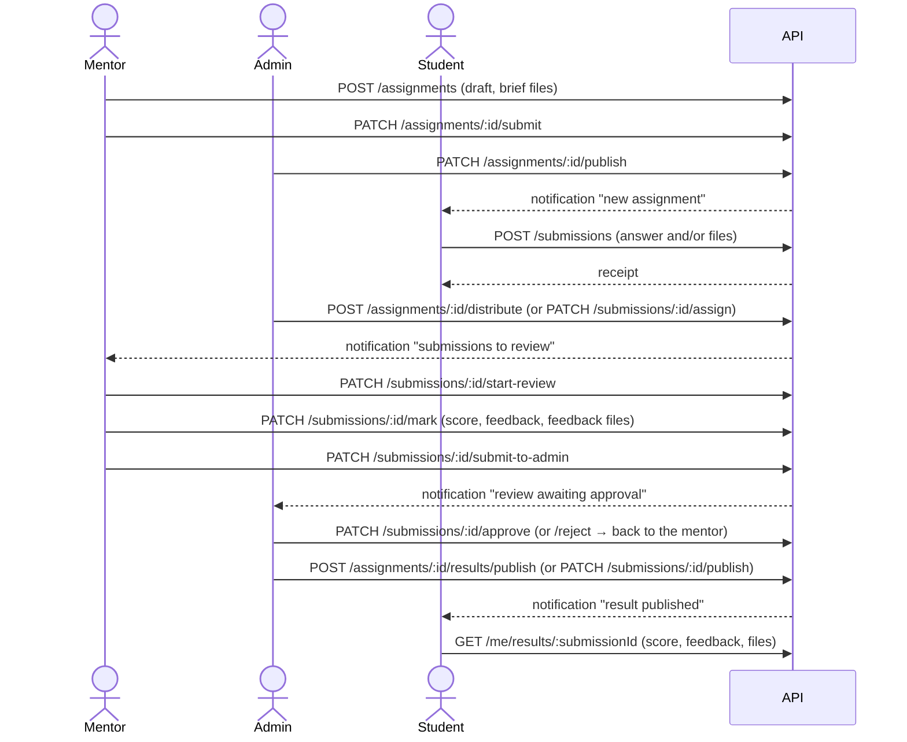

# ROF LMS — Business workflows

How work moves through the platform, who does each step, the endpoint for it
and what everyone else sees. Every transition is a conditional update
(`UPDATE … WHERE status IN (allowed)`), so two people acting at once can never
corrupt a record: the loser gets `409 INVALID_STATE_TRANSITION`. Every step is
written to the audit log.

Contents: [Accounts](#1-accounts) · [Academic year](#2-academic-year) ·
[Courses and resources](#3-courses-and-learning-resources) ·
[Assignment → result](#4-from-assignment-to-published-result) ·
[Resubmissions](#5-resubmissions) · [Corrections](#6-corrections-after-publication) ·
[Discussions and moderation](#7-discussions-and-moderation) ·
[Live sessions](#8-live-sessions) · [Notifications](#9-notifications)

---

## 1. Accounts



- Accounts that were never activated cannot log in. "Forgot password" sends
  them a fresh activation link instead.
- Suspending an account, changing its role, or a password change/reset ends
  every session immediately: refresh tokens are revoked and earlier access
  tokens are refused.
- Five wrong passwords in a row lock an account for 15 minutes from every
  address. The response never reveals the lock.

## 2. Academic year

`PLANNED → ACTIVE (current) → CLOSED`. Exactly one year is current (a unique
index enforces it).

1. Admin creates the next year: `POST /admin/academic-years`.
2. Admin activates it: `POST /admin/academic-years/:id/activate`. In one
   transaction:
   - the previous year closes and its assignments are archived (results stay visible);
   - every active student is promoted one grade (S6 graduates), which moves
     students from S3 to the Senior division;
   - a new enrolment row is written for the year.
3. During the year, admins correct an enrolment (grade, withdrawal) with
   `PATCH /admin/enrollments/:id`. Changing a student's grade in their profile
   updates the current enrolment too. Both are audited with the values before
   and after.

## 3. Courses and learning resources

The four courses (Algebra, Geometry, Number Theory, Combinatorics) are fixed
and created by the seed; admins edit, publish, unpublish or archive them.
Course discussions can be switched off per course.

Resources belong to a course × division:

```
draft ─publish─► published ─unpublish─► draft
   └──────────────── archive ─► archived ─restore─► draft
```

Mentors manage resources in the course × division scopes they are assigned
to; admins everywhere. Students see published resources of their own division
in published courses. Opening a course marks it "Rolled"; a student may then
mark it completed.

## 4. From assignment to published result

The full flow, end to end (covered by `test/workflow.e2e-spec.ts`):



**Assignment states.**

```
DRAFT ─submit─► PENDING_APPROVAL ─publish─► PUBLISHED ─deadline / admin close─► CLOSED
  ▲ ◄──recall──┘        │ reject (note)            │ unpublish (no submissions yet)
  └──── REJECTED ◄──────┘                           └─► DRAFT
any state ─admin archive / year closes─► ARCHIVED
```

- A CLOSED assignment accepts no new work, except resubmissions a mentor
  asked for. Assignments that accept late work stay open after the deadline
  until an admin closes them.
- A reminder goes to students who have not submitted, once per deadline,
  before it passes (default 24 h; set in the settings).
- Defaults for resubmissions and late work come from the system settings;
  the mentor can choose differently for each assignment.

**Submission states.**

```
SUBMITTED ─assign/distribute─► ASSIGNED ─start─► IN_REVIEW ─mark─► MARKED ─submit to admin─► SUBMITTED_TO_ADMIN
                                                      ▲                                         │approve   │reject
                                                      └──────────── REJECTED ◄───────────────────┼──────────┘
                                                                                                 ▼
                         student sees the result ◄── PUBLISHED ◄──publish── APPROVED
```

- Distribution only uses mentors assigned to the assignment's course ×
  division. `BALANCED` gives work to whoever has the fewest open reviews;
  `ROUND_ROBIN` takes turns.
- Only the assigned mentor can open, score and give feedback. Reassigning
  starts a new review cycle; the earlier cycle stays in the history.
- Administrators approve, return with a reason, and publish. They can never
  score or write academic feedback (those endpoints are mentor-only).
- Students see nothing of the review — score, feedback, feedback files —
  until publication. Formal results have no reply box; questions go to the
  assignment's discussion.
- Publication awards points: `round(points × score / maximumMarks)`. The
  leaderboard ranks students per division.

Student-facing labels: Not Started · Submitted · Pending Review · Resubmission
Requested · Reviewed.

## 5. Resubmissions

- **The student chooses to resubmit:** allowed while the work is waiting
  (SUBMITTED or ASSIGNED), before the deadline, within the assignment's limit.
  Each attempt is kept as a numbered revision with its own files.
- **The mentor asks for it:** `PATCH /submissions/:id/request-resubmission`,
  with a note and a due date (default from the settings, at most 60 days). The
  student is notified and may resubmit until that date, even if the assignment
  has closed. The new attempt goes straight back to the same mentor. The
  mentor can withdraw the request.

## 6. Corrections after publication

`PATCH /submissions/:id/reopen` (admin, with a reason) withdraws a published
result: the student no longer sees it, its points are removed, and a new
review cycle goes to the mentor. When it is published again, the student sees
the new result and the earlier published score under "previous versions". The
admin's reason stays internal. `GET /submissions/:id/result-history` (admin)
lists every publication with who published it and when.

## 7. Discussions and moderation

- **Course threads** belong to a course × division. **Assignment threads**
  belong to one assignment. Students, mentors and admins in that scope can
  post; replies go one level deep; reactions are LIKE, HELPFUL and CONFUSED.
- Authors edit their own posts. They delete their own comments, and their own
  threads while nobody else has posted.
- Anyone can report a thread or comment. The report keeps a copy of the text
  as reported, and administrators are notified.
- Administrators review reports (`GET /admin/moderation/reports/:id` shows
  every report and past action on the item). They can then:
  - hide or restore content;
  - remove it (the text stays on record, invisible to users);
  - lock, archive or pin threads;
  - dismiss the report.

  Acting on content closes its open reports. The author is told what happened
  and why, and reporters are told the outcome.
- There is no private or direct messaging, and there are no study groups.

## 8. Live sessions

```
SCHEDULED ─host/admin cancels─► CANCELLED
    └──────── end time passes ─► COMPLETED (worker)
```

- **Scheduling:** mentors schedule sessions for their course × division
  scopes. Times are given as a date plus start and end time in the programme
  time zone, or as ISO instants.
- **Checks:**
  - the session must start in the future and end after it starts;
  - it can last at most the configured length;
  - it must start within the academic year;
  - the host can't be double-booked, and a division can't have two sessions
    at once;
  - the platform, if given, must match the meeting link.
- **During a session:** its time can't be changed, but the link can.
- **Visibility:** students see their division's sessions in published courses.
  A cancelled session hides its link from them.
- **Notifications:** students are told when a session is scheduled, its time
  or link changes, it is cancelled, and shortly before it starts.

## 9. Notifications

Each event notifies the people it concerns, in the app and (for some types)
by e-mail through the background outbox. See the event → recipient table in
[ARCHITECTURE.md §7](ARCHITECTURE.md#7-notifications).

- Users mark notifications read or unread and see unread counts per category.
- Administrators and mentors choose, per notification type, whether they get
  it in the app and/or by e-mail (`/me/notification-settings`).
- Everyone can turn off e-mail per category (`/me/notification-preferences`).
- Account e-mails (activation, password reset) are always sent.
